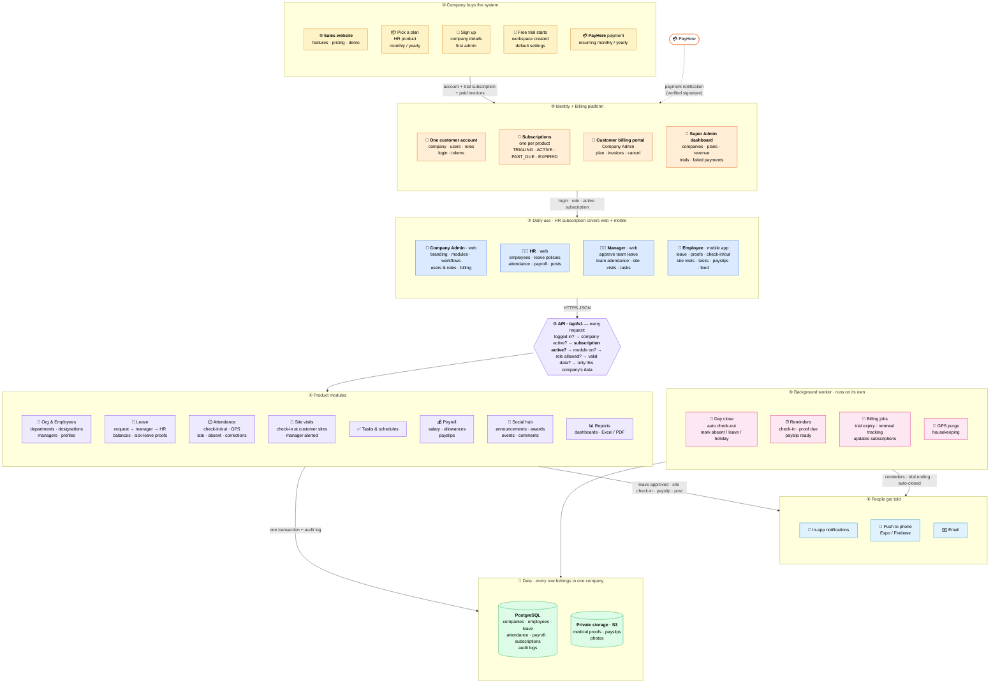

# Employee Management SaaS

Multi-tenant Employee Management SaaS platform. See `CLAUDE.md` for the project
guide and `docs/` for the Phase 1 design (architecture, database schema,
permissions, API).

## How the complete system works



1. **A company buys the system** on the sales website: it picks a plan, signs up, gets a free trial
   with its own workspace, and pays through PayHere (monthly or yearly, renewed automatically).
2. **The Identity + Billing platform** holds one account per company, its users and roles, and one
   subscription per product. Company Admins manage billing in the customer portal; the platform team
   watches every company, plan and payment from the Super Admin dashboard. PayHere confirms each
   payment with a signed notification.
3. **Daily use:** Company Admin, HR and Managers work in the web portal; employees use the mobile app.
   One HR subscription covers both.
4. **Every request** passes the same checks, including "is this company's subscription active?",
   and only ever sees its own company's data.
5. **The background worker** closes each work day, sends reminders, tracks trial expiry and renewals,
   and clears old GPS data.
6. **People are told** through in-app notifications, phone push and email.


## Stack

```
apps/api        Node.js, Express, TypeScript (strict), Prisma, PostgreSQL, Zod, Vitest
apps/web        React, TypeScript, Vite, React Router, TanStack Query, Tailwind (Step 1.5)
apps/mobile     Expo (Step 1.6) — placeholder package for now
packages/shared Zod schemas, shared types, enums (used by api, web, mobile)
```

## Prerequisites

- Node.js 20+ (tested with v22)
- pnpm (tested with 12.16.1) — `npm install -g pnpm` if you don't have it
- Docker Desktop (for Postgres and Mailpit)

## First-time setup

```bash
# 1. Start Postgres and Mailpit
docker compose up -d

# 2. Install all workspace dependencies
pnpm install

# 3. Copy the API env files and adjust if needed (defaults match docker-compose.yml)
cp apps/api/.env.example apps/api/.env
cp apps/api/.env.test.example apps/api/.env.test

# 4. Generate the Prisma client, create the dev database schema
pnpm --filter @employee-saas/api db:generate
pnpm db:migrate

# 5. Seed demo data (2 companies, each with an admin, HR, manager, 3 employees, plus 1 platform super admin)
pnpm db:seed
```

## Running

```bash
pnpm dev        # runs the API (http://localhost:4000), the web app (http://localhost:5173) and the background worker
pnpm test       # runs all workspace test suites (apps/api needs docker compose up first)
pnpm typecheck  # tsc --noEmit across all workspaces
pnpm lint       # eslint across all workspaces
```

## Running tests (separate database)

Tests never touch the dev database - they run against `employee_saas_test`,
a separate database on the same Postgres container (created automatically by
`scripts/postgres-init/001-create-test-db.sql` on a fresh `docker compose up`;
if you started the container before this existed, create it once with
`docker compose exec postgres psql -U employee_saas -d employee_saas -c "CREATE DATABASE employee_saas_test OWNER employee_saas"`).

`apps/api/.env.test` points at that database. Running `pnpm test` (inside
`apps/api`) automatically applies any pending migrations to it first (via a
`pretest` script), then runs Vitest. Every single test also truncates all
tables before it runs (a global `beforeEach` in `src/test/setupDb.ts`), so
tests never see leftover data from a previous test, dev data, or seed data -
each test starts from a completely empty database and sets up whatever rows
it needs.

## The background worker

`pnpm dev` also starts the worker (`apps/api/src/worker.ts`). Every 30 seconds it runs whatever is
due, **against your dev database**:

| Job | When (company time) | What it does |
|---|---|---|
| Day close | as each shift's close time passes | forgotten check-outs become `INCOMPLETE`, no-shows `ABSENT` |
| Visit auto-close | 16 h after a site check-in | closes a forgotten site visit |
| Check-in reminder | shift start + offset | "You haven't checked in yet" (Company settings switch) |
| Proof reminders | daily reminder time | "due tomorrow" to the employee, "overdue" to HR, once each (switch) |
| GPS purge | 03:00 | clears coordinates older than the retention days; never deletes rows |
| Housekeeping | 04:00 UTC | deletes `job_runs` older than 30 days |

Set `JOBS_ENABLED=false` in `apps/api/.env` to turn it off. `pnpm --filter @employee-saas/api worker --once`
runs one tick and exits.

Health check: `GET http://localhost:4000/api/v1/health` — returns `{ "status": "ok", "db": "ok", "timestamp": "..." }`
if the API can reach Postgres.

Mailpit UI: http://localhost:8025.

## File storage

`STORAGE_DRIVER` in `apps/api/.env` picks the backend - `local` (default,
dev/test) writes to `STORAGE_LOCAL_PATH` (`./storage-data`, gitignored) on
the API's own disk and serves downloads through this API itself; `s3` uses
a real S3-compatible bucket via the `S3_*` settings. No separate container
needed for either - see `docs/architecture.md` §6 for the full design
(this replaced an earlier MinIO-container plan; MinIO's 2024 licensing
change made it impractical to pull in a disposable dev/CI environment).

## Seeded accounts

All seeded users share the password `Passw0rd!`. Company codes: `ACME`, `BETA`.
HR and Manager are also employees (with their own leave balances) - only
Company Admin has no employee profile. Login identifier can be the email
*or* the employee code shown below.

| Company code | Role | Email | Employee code |
|---|---|---|---|
| ACME | COMPANY_ADMIN | admin@acme.test | — |
| ACME | HR | hr@acme.test | ACM-EMP-001 |
| ACME | MANAGER | manager@acme.test | ACM-EMP-002 |
| ACME | EMPLOYEE | alex@acme.test | ACM-EMP-003 |
| ACME | EMPLOYEE | jordan@acme.test | ACM-EMP-004 |
| ACME | EMPLOYEE | taylor@acme.test | ACM-EMP-005 |
| BETA | COMPANY_ADMIN | admin@beta.test | — |
| BETA | HR | hr@beta.test | BETA-EMP-001 |
| BETA | MANAGER | manager@beta.test | BETA-EMP-002 |
| BETA | EMPLOYEE | alex@beta.test | BETA-EMP-003 |
| BETA | EMPLOYEE | jordan@beta.test | BETA-EMP-004 |
| BETA | EMPLOYEE | taylor@beta.test | BETA-EMP-005 |

Platform-level account - log in with **no company code**, email only:

| Role | Email |
|---|---|
| SUPER_ADMIN | superadmin@platform.test |

## Auth (Steps 1.2-1.3)

`POST /api/v1/auth/login` takes `{ companyCode, identifier, password }` -
`companyCode` is required; `identifier` is either an employee code or an
email, scoped to the company resolved from `companyCode`. The platform
`SUPER_ADMIN` account has no company, so it uses a **separate** endpoint,
`POST /api/v1/auth/platform/login`, with `{ email, password }` and no
company code - rate-limited more tightly (5/15min per IP, vs. 10/15min per
IP+company-code on the regular login) since a compromised platform account
can affect every company. **MFA for platform admin accounts is planned for
Phase 4** - not implemented yet.

Every failure (unknown company, unknown identifier, wrong password,
deactivated user, suspended company) returns the exact same `401
INVALID_CREDENTIALS` response, so a caller can't use the error to figure out
which part was wrong.

A freshly created login (new employee, new standalone user, a new company's
first admin) gets a one-time system-generated password and
`mustChangePassword: true`. While that flag is set, every endpoint except
`POST /auth/change-password` returns `403 PASSWORD_CHANGE_REQUIRED` -
checked fresh on every request, so it can't be bypassed by reusing an old
access token.

**Web vs. mobile clients** - send the header `X-Client: mobile` to get the
mobile behavior; omit it for the default (web) behavior:

- **Web** (default): access + refresh tokens are set as httpOnly, `SameSite=Strict`
  cookies (`Secure` in production). The browser sends them automatically;
  the response body never contains a token. This is the safer option for a
  browser, since JS on the page (including injected XSS payloads) can never
  read an httpOnly cookie.
- **Mobile** (`X-Client: mobile`): there's no browser cookie jar on a React
  Native app, so tokens are returned in the JSON response body instead. The
  app stores them in `expo-secure-store` (OS keychain/keystore) and sends
  the access token as `Authorization: Bearer <token>` on every request, and
  the refresh token in the body when calling `/auth/refresh`.

Access tokens are short-lived JWTs (15 min, claims: `userId`, `companyId`,
`role`). Refresh tokens are long-lived (30 days) random strings - the DB
only ever stores a SHA-256 hash of one, never the token itself. See the
report for Step 1.2 for a plain-language explanation of refresh rotation.

## Company & employee management (Step 1.3)

Full CRUD for companies (`SUPER_ADMIN` only), a company's own profile,
settings, and holidays, standalone users, departments, designations, and
employees - see `docs/api-phase1.md` for the endpoint list and
`docs/permissions.md` for who can do what.

A few things worth knowing:
- **Employee codes** (`employeeIdPrefix` + a running number from
  `company_settings`) are generated with an atomic `UPDATE ... RETURNING` -
  two employees created at the same instant can never collide.
- **Manager assignment** is rejected if the proposed manager isn't an active
  employee in the same company, is the employee themselves, or would create
  a reporting cycle (walks the chain up from the proposed manager looking
  for the employee being updated).
- **Deactivating an employee** also deactivates their login, revokes all
  their refresh tokens, and (as of Step 1.4) auto-cancels any of their
  still-pending leave requests, releasing the reserved days back to their
  balance.
- **A company always keeps at least one active `COMPANY_ADMIN`**: an admin
  can't deactivate themselves or remove their own admin role, and the last
  active admin can't be removed by anyone - whether through the users
  endpoints or (for the rare case where an admin was promoted from an
  employee login and still has an employee profile) the employee
  deactivation endpoint.
- Department/designation names are unique per company **case-insensitively**
  ("Engineering" and "engineering" collide) via a hand-written functional
  index - see `docs/database-schema.md`.

`PATCH /users/:id` changes role; `POST /users/:id/reset-password`
(COMPANY_ADMIN, or HR for non-admin targets) handles password resets.

## Leave module (Step 1.4)

Leave types, balances, requests, approvals, and sick leave documents - see
`docs/api-phase1.md` for the endpoint list and `docs/architecture.md` §3
for the full request-flow design this follows exactly.

- **Day calculation** (`apps/api/src/lib/leaveDays.ts`) weighs each calendar
  day by `company_settings.workingDays` (FULL/HALF/OFF per weekday - a
  half-Saturday by default) and zeroes out company holidays, then halves
  the start/end day if its half-day flag is set. A result of 0 (e.g. a
  request entirely on a weekend) is rejected.
- **Validation on submit**: the date range must stay within one calendar
  year; it can't overlap an existing pending/approved request for the same
  employee; past dates are rejected unless the leave type allows them
  (sick leave does, up to 30 days back).
- **Balance math** - `pendingDays` is reserved at submission (inside a
  transaction that locks the balance row, so two concurrent submissions
  can't both pass the same stale balance check), then:
  - **approve** (at the final step) moves those days from `pendingDays` to
    `usedDays`;
  - **reject** or **cancel** releases `pendingDays` - nothing was ever used;
  - **revoke** (an already-approved *future* request only) removes the
    days from `usedDays` - they'd already left `pendingDays` at approval
    time, so there's nothing left there to touch.
  - `leave_balances.usedDays`/`pendingDays` both have a DB `CHECK (... >= 0)`
    as a last line of defense behind this math.
- **Approval routing**: `MANAGER_ONLY` or `MANAGER_THEN_HR` (a company
  setting). No manager on file → straight to the HR step. HR can always
  step in at the manager step as a fallback, and that decision is final (it
  doesn't go on to a redundant HR step). Nobody decides their own request,
  and a step can't be decided twice.
- **Sick leave documents**: multipart upload (max 5 MB, jpg/png/pdf),
  content-type checked both by what the client declares *and* by sniffing
  the actual bytes (the `file-type` package) - a renamed `.exe` is
  rejected either way. Uploading moves `proofStatus` from `MISSING`/
  `INFO_REQUIRED` to `SUBMITTED`; HR's review (`ACCEPTED`/`REJECTED`/
  `INFO_REQUIRED`) updates both the document and the parent request.
  Managers can never view or download a document, even their own direct
  report's - only the leave *decision* is their concern.

## Web portal (Step 1.5)

Run `pnpm dev` (from the repo root) and open **http://localhost:5173**. The
Vite dev server proxies `/api/*` to the API on port 4000, so the browser
sees everything as same-origin and the httpOnly auth cookies work without
any CORS setup.

- Company sign-in: **http://localhost:5173/login** - company code + email
  (or employee code) + password. Use any row from the "Seeded accounts"
  table above.
- Platform admin sign-in: **http://localhost:5173/platform/login** - email +
  password, no company code. Use `superadmin@platform.test`.
- The sidebar and available pages change by role (UX only - the API is the
  real security boundary either way):
  - **COMPANY_ADMIN**: Employees, Users, Departments, Designations, Leave
    requests, Leave types, Holidays, My leave, Settings.
  - **HR**: same as Company Admin minus Users' role-change/activate controls
    (view + reset-password only) and minus Settings.
  - **MANAGER**: Employees (scoped to direct reports = "my team"), Leave
    requests (team view), My leave.
  - **EMPLOYEE**: My leave only.
  - **SUPER_ADMIN**: Companies (platform-wide), via the `/platform/login`
    sign-in above.

Web app commands (run from `apps/web`, or prefix with
`pnpm --filter @employee-saas/web`):

```bash
pnpm dev          # Vite dev server on :5173 (also started by the root `pnpm dev`)
pnpm test         # Vitest + React Testing Library + MSW component/unit tests
pnpm test:e2e     # Playwright end-to-end smoke test against the real dev API -
                   # needs the dev DB seeded and reachable; starts/reuses the
                   # api+web dev servers itself
pnpm typecheck
pnpm lint
pnpm build        # production build (tsc -b && vite build)
```

The Playwright test (`apps/web/e2e/leave-approval.spec.ts`) logs in as an
employee, applies for leave, logs in as their manager to approve it, then
logs back in as the employee to confirm the request shows `APPROVED` and the
balance reflects it - then cleans up by revoking the request as
`COMPANY_ADMIN` so reruns on the same day don't collide with it.

## Run the app on your phone

A step-by-step walkthrough for running the mobile app in Expo Go on an
Android phone, written for a first time through.

**1. Same Wi-Fi network.** Your phone and your computer need to be on the
same Wi-Fi network. A work VPN or a "guest" network that isolates devices
from each other often won't work - try a normal home Wi-Fi first.

**2. Find your computer's LAN IP.** On Windows, open a terminal and run:

```
ipconfig
```

Look for "IPv4 Address" under your active adapter (usually "Wireless LAN
adapter Wi-Fi"). It looks like `192.168.1.100`. That's the address your
phone uses to reach your computer - not `localhost`, which only means
"this same device".

**3. Point the mobile app at your API.** Copy `apps/mobile/.env.example` to
`apps/mobile/.env` and set `EXPO_PUBLIC_API_URL` to that IP:

```
EXPO_PUBLIC_API_URL=http://192.168.1.100:4000/api/v1
```

**4. Allow port 4000 through the Windows Firewall.** The API listens on
port 4000. Windows Firewall blocks incoming connections from other devices
on the network by default, including your phone. Allow it once, in an
elevated (Administrator) PowerShell:

```powershell
New-NetFirewallRule -DisplayName "Employee SaaS API (dev)" -Direction Inbound -Protocol TCP -LocalPort 4000 -Action Allow
```

**5. Start the API, then start Expo.** In one terminal:

```
pnpm --filter @employee-saas/api dev
```

In a second terminal:

```
pnpm --filter @employee-saas/mobile start
```

This prints a QR code. Install **Expo Go** from the Play Store on your
Android phone, open it, and scan the QR code from Expo Go's own scanner
(not your phone's regular camera app).

**6. Log in.** Use any seeded HR, Manager, or Employee account from the
table above, e.g. company code `ACME`, employee code `ACM-EMP-003` (or
email `alex@acme.test`), password `Passw0rd!`. Company Admin accounts have
no employee profile and will see the "This app is for employees" screen
instead.

**Common errors and fixes**

| Error | Fix |
|---|---|
| "Could not reach the server. Check your Wi-Fi and the API URL." (network request failed) | Phone and computer aren't on the same Wi-Fi, the firewall rule from step 4 is missing, or `EXPO_PUBLIC_API_URL` still says `localhost` instead of your LAN IP. Env vars are only read when Expo starts, so restart `expo start` after editing `.env`. |
| Expo Go shows "Project is incompatible with this version of Expo Go" (SDK mismatch) | Expo Go's installed version doesn't match this project's Expo SDK (currently 58). Update Expo Go from the Play Store. |
| Metro can't resolve `@employee-saas/shared` ("Unable to resolve module") | Metro started before `pnpm install` finished linking the workspace, or `apps/mobile/metro.config.js`'s `watchFolders`/`nodeModulesPaths` wiring is missing. Stop Expo, re-run `pnpm install` at the repo root, then restart with `pnpm --filter @employee-saas/mobile start -- --clear` to also clear Metro's cache. |
| "Unable to resolve ./roles.js from packages/shared/src/index.ts" (or any other `packages/shared` file ending in `.js`) | `packages/shared` imports its own files with a `.js` extension that actually points at a `.ts` file (standard TypeScript "NodeNext" style) - Metro doesn't resolve that the way `tsc`/Vite do. `apps/mobile/metro.config.js`'s `resolver.resolveRequest` override handles this already; if you still see it, `metro.config.js` was reverted or edited. Restart with `pnpm --filter @employee-saas/mobile start -- --clear` after fixing it. |

### Run it from your own dev build (step 2.9a)

A **development build** ("dev build") is your own installable copy of the app.
It's like Expo Go, but it contains exactly this project's native code. It still
loads the JavaScript live from `expo start` on your PC, so code changes appear
just as they do in Expo Go. Push notifications (step 2.9b) only work in a dev
build, since Expo Go no longer supports them on Android.

**Install it (once per build):** open the build's page on expo.dev on your
phone (Builds, in the `employee-saas-mobile` project), tap **Install**, and
open the downloaded APK. Android asks to allow installing apps from your
browser the first time. The app is called **Employee SaaS**, and it sits next
to Expo Go without replacing it.

**Run it:** start the API and Expo as in step 5. Since `expo-dev-client` is
installed, `expo start` now opens in **development build** mode. Open the
Employee SaaS app on the phone and pick your PC from the list of servers, or
scan the QR code with the phone's camera. To use Expo Go instead, press **`s`**
in the Expo terminal to switch modes, then scan as before.

**When to rebuild:** only when something native changes: a new library with
native code, or `app.json` plugins and permissions. JavaScript changes never
need a rebuild. To build, in `apps/mobile` (it asks questions, so use your own
terminal):

```
npx eas-cli@27.5.0 build --profile development --platform android
```

The settings are in `apps/mobile/eas.json`. The cloud build uses node and pnpm
versions pinned there, matching this repo's lockfile. The app's signing key is
stored on your Expo account, not in the repo.

| Problem | Fix |
|---|---|
| The dev build app shows no servers | Phone and PC on different Wi-Fi, or Windows Firewall blocks Metro's port 8081. Scan the QR code instead, or enter the URL shown by `expo start` by hand. |
| "No development build installed" / `expo start` asks for a build | You opened Expo Go while in dev build mode: press `s` to switch, or open the Employee SaaS app instead. |
| The app crashes on start after adding a library | The library has native code and needs a rebuild. Run `npx expo-doctor` in `apps/mobile` first: a missing peer dependency or a duplicate native module also crashes a dev build. |

Technical note on file downloads: once your phone can reach the API at
all, sick leave proof documents work the same way with no extra
configuration - the `local` storage driver serves them from this same API
at `/api/v1/files/download`. Only `STORAGE_DRIVER=s3` needs its own
LAN-reachable address: set `apps/api/.env`'s `S3_PUBLIC_URL` to your LAN IP
in that case (it defaults to `http://localhost:9000`, which only works
from the same machine).

## Known limitations

- No in-app notification UI yet — rows are written (`createNotification`) and a web screen to read them lands in Step 1.7.
- Automated proof-deadline reminders aren't implemented — `leave_requests.proofDueAt` is stored but nothing currently acts on it.
- The web portal's HR leave-requests "Pending" tab and its employee/leave-type filter dropdowns fetch up to 100 rows client-side rather than paginating server-side for every case — fine at Phase 1's scale, revisit if a company exceeds ~100 employees or concurrent pending requests.
- Mobile sick-leave proof upload (camera/gallery/file picking, image compression) has no automated test coverage beyond the client-side file-validation logic (type/size rejection) — the native pickers themselves aren't exercised by the test suite and need a manual check on a real device.
